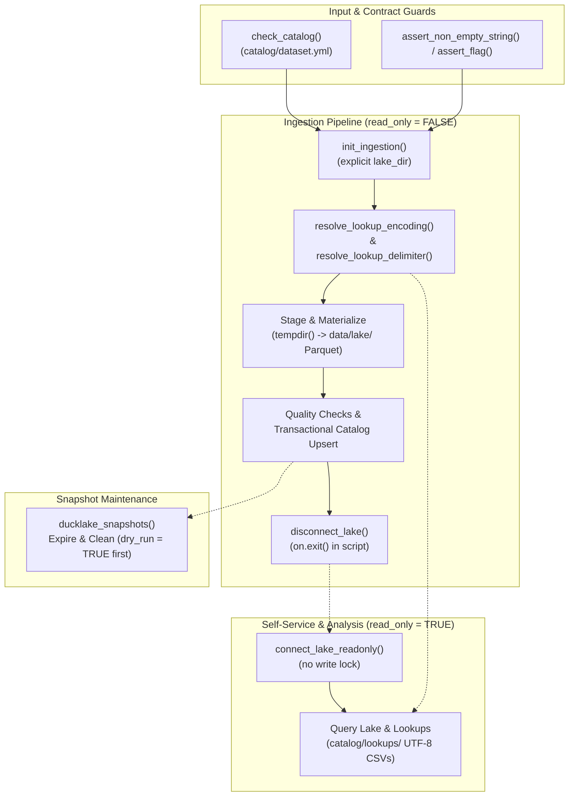

# dlman

<!-- badges: start -->
<!-- badges: end -->

`dlman` provides DataOps utilities for managing local, server-free
[DuckLake](https://ducklake.select/) lakehouses in R with DuckDB and spatial
extensions. It separates reusable lakehouse operations—such as connection
management, catalog contract validation, lookup CSV encoding/delimiter
resolution, and safe read-only analysis access—from dataset-specific ingestion
scripts and lake storage.

## Installation

You can install the development version of dlman from
[GitHub](https://github.com/) with:

```r
# install.packages("pak")
pak::pak("beausoleilmo/dlman")
```

## Features

- **Session & connection lifecycle:** Open read-write ingestion sessions
  (`init_ingestion()`) or safe read-only analysis connections
  (`connect_lake_readonly()`), and close connections cleanly
  (`disconnect_lake()`).
- **Catalog contract validation:** Validate YAML dataset contracts
  (`catalog/dataset.yml`) before ingesting or mutating data.
- **Lookup CSV helpers:** Resolve file encoding (`resolve_lookup_encoding()`)
  and column delimiters (`resolve_lookup_delimiter()`) for reference tables
  under `catalog/lookups/`, with `ASCII` treated as compatible with `UTF-8` and
  clear `cli` diagnostics.
- **Project-agnostic lake paths:** Pass `lake_dir` explicitly to functions so
  the same package supports production lakehouses, scripts, and isolated
  `testthat` temporary lakes.

## Workflow


